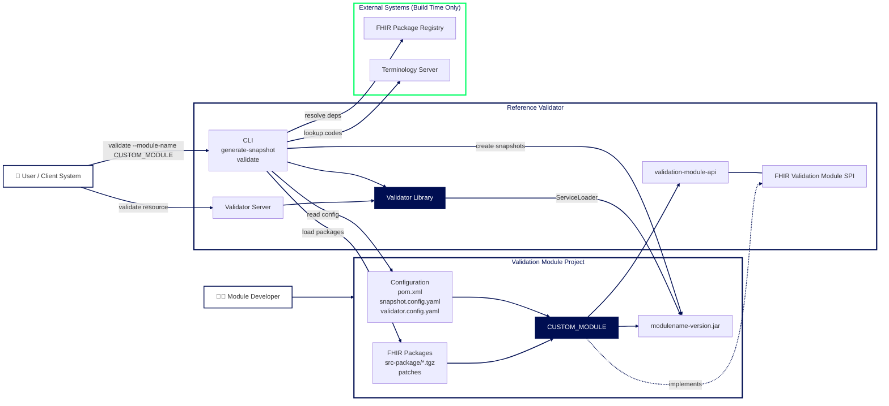

# Creating a Validation Module for the gematik Reference Validator

## 1. Concepts

A validation module is a small JAR that contains:

1. **A Java SPI class** that gives the module its name (`FhirValidationModule`).
2. **A module manifest** (`META-INF/config.yaml`) that lists package groups, profile families, versions with their optional validity dates, and validation rules.
3. **Pre-snapshotted FHIR packages** (`package/*.tgz`). The build process generates them automatically, based on the module manifest definitions.

The Reference Validator finds modules with the Java `ServiceLoader`. It reads the manifest and loads the packaged FHIR packages **offline**. No registry or terminology server is needed at validation time.

The module lifecycle has two phases. Each phase has its own configuration file:

| Phase               | Config file             | Maven phase          | CLI command         | Network                         |
| ------------------- | ----------------------- | -------------------- | ------------------- | ------------------------------- |
| Snapshot generation | `snapshot.config.yaml`  | `generate-resources` | `generate-snapshot` | Allowed (registry, tx.fhir.org) |
| Module validation   | `validator.config.yaml` | `verify`             | `validate`          | Disallowed (offline)            |

---

## 2. Relation between a Validation Module and the Reference Validator



---

## 3. Project layout

```
valmodule-<name>/
├── pom.xml                         # inherits validation-module-parent
├── snapshot.config.yaml            # build-time config (network allowed)
├── validator.config.yaml           # verify-time config (should run in offline mode)
├── README.md / ReleaseNotes.md
└── src/
    ├── main/
    │   ├── java/de/gematik/refv/valmodule/<Name>ValidationModule.java
    │   └── resources/
    │       ├── META-INF/
    │       │   ├── config.yaml                                   # module manifest
    │       │   └── services/
    │       │       └── de.gematik.refv.valmodule.api.boundary.FhirValidationModule
    │       └── src-package/                                      
    │           ├── <package-id>-<version>.tgz                    # only for the "bundled" strategy
    │           └── patches/<package-id>#<version>/               # optional patches overriding packages content
    │               ├── <ResourceFile>.json
    │               └── changes.txt
    └── test/
        └── resources/fhir/...                                    # test instances
```

The build process puts **only** these resource files in the final JAR:

- `src/main/resources/META-INF/**`
- `target/generated-resources/package/**/*.tgz` (the generated FHIR Packages with snapshots)

All the `src-package` sources are **not** shipped/included in the final JAR file, but they are only used as source for the generation of snapshots.

---

## 4. Step by step: creating a new module

### 4.1 `pom.xml`

```xml
<project>
  <modelVersion>4.0.0</modelVersion>

  <parent>
    <groupId>de.gematik.refv</groupId>
    <artifactId>validation-module-parent</artifactId>
    <version>3.0.0-SNAPSHOT</version>
  </parent>

  <groupId>de.gematik.refv.valmodule</groupId>
  <artifactId>myig</artifactId>               <!-- JAR name: myig-<version>.jar -->
  <version>1.0.0-SNAPSHOT</version>
  <name>valmodule-myig</name>
  <description>MyIG Validation Module for the Reference Validator</description>
  <!-- Pins all the required versions -->
  <dependencyManagement>
    <dependencies>
      <dependency>
        <groupId>de.gematik.refv</groupId>
        <artifactId>bom</artifactId>
        <version>${project.parent.version}</version>
        <type>pom</type>
        <scope>import</scope>
      </dependency>
    </dependencies>
  </dependencyManagement>

  <dependencies>
    <dependency>
      <groupId>de.gematik.refv</groupId>
      <artifactId>validation-module-api</artifactId>
    </dependency>
  </dependencies>

  <build>
    <plugins>
      <plugin>
        <groupId>com.diffplug.spotless</groupId>
        <artifactId>spotless-maven-plugin</artifactId>
      </plugin>
      <!-- activates the build-snapshot and validate-module executions from the parent -->
      <plugin>
        <groupId>org.codehaus.mojo</groupId>
        <artifactId>exec-maven-plugin</artifactId>
      </plugin>
    </plugins>
  </build>
</project>
```

The parent's `exec-maven-plugin` management runs `de.gematik.refv.cli.ReferenceValidator` from `referencevalidator-cli` twice:

| Execution ID      | Phase                | Arguments                                                                                                                                                    |
| ----------------- | -------------------- | ------------------------------------------------------------------------------------------------------------------------------------------------------------ |
| `build-snapshot`  | `generate-resources` | `generate-snapshot --config=snapshot.config.yaml --module-manifest=src/main/resources/META-INF/config.yaml --output-dir=target/generated-resources/package/` |
| `validate-module` | `verify`             | `validate --config=validator.config.yaml src/test/resources/fhir/`                                                                                           |

The parent sets `blockSystemExit=true`, so a non-zero exit code from the CLI fails the Maven build.

### 4.2 SPI implementation

```java
package de.gematik.refv.valmodule;

import de.gematik.refv.valmodule.api.boundary.FhirValidationModule;

/** Definition of the MyIG Validation Module */
public class MyIgValidationModule implements FhirValidationModule {
  @Override
  public String getName() {
    return "myig";
  }
}
```

Register it in `src/main/resources/META-INF/services/de.gematik.refv.valmodule.api.boundary.FhirValidationModule`:

```
de.gematik.refv.valmodule.MyIgValidationModule
```

Keep these values identical:

- `getName()`
- `name` in `META-INF/config.yaml`
- `module.name` in `validator.config.yaml`

### 4.3 Module Manifest 

The Manifest must be defined in [`META-INF/config.yaml`](../src/main/resources/META-INF/config.yaml). The template ships this file with placeholders (`MODULE_NAME`, `MODULE_DESCRIPTION`, `MODULE_VERSION`, `YOUR_SPEC_URL`, `YOUR_PACKAGE_GROUP_ID`, `YOUR_CANONICAL_BASE`, `YOUR_VERSION`). Replace all of them.

At the time of writing, the current specification for the Manifest is `3.0`, so it is defined as property `configSpecVersion: '3.0'`.

#### Terminology

| Term                 | Meaning |
| -------------------- | ------- |
| `packageGroup`       | A named, immutable set of FHIR packages that are **always loaded together**. It contains no dates and no references to other groups: what you read is exactly what gets loaded. |
| `profileFamily`      | A set of FHIR profiles that share the same canonical base URL and the same release cycle (e.g. all KBV e-prescription profiles). |
| `version`            | A supported profile version, as found after the `\|` in a canonical (e.g. `https://fhir.kbv.de/...\|1.0.2`). Each version declares **which** package group is active **when**. |
| `groups`             | A list of entries binding a package group **by name** (`packageGroupName`) to an explicit date range `[validFrom, validTill]`. An entry **without** `validTill` is open-ended: it is the currently active group and serves as the fallback when no reference date can be determined. At most **one** open-ended entry per version. |
| `validityDateSource` | A FHIRPath expression evaluated against the resource to extract the reference date (formerly `creationDateLocator`). |

#### Example

A typical Manifest can look like this:

```yaml
configSpecVersion: '3.0'
name: myig                          # must equal getName()
author: 'My Organisation'
description: 'Reference Validator Module for MyIG'
version: '1.0'
specUrl: 'https://simplifier.net/packages/my.ig'

# These properties override the ones defined in the YAML file used for the validation
errorOnUnknownProfile: true         # unknown meta.profile -> error 
anyExtensionsAllowed: false         # unknown extensions -> error

# Not validated offline (no terminology server at validation time)
ignoredCodeSystems:
  - "http://snomed.info/sct"
  - "http://loinc.org"
ignoredValueSets:
  - "http://example.org/fhir/ValueSet/large-external-vs"

# Optional, suppress messages globally, documented with a reason
globalSuppressionRules:
  - ruleId: "GLOBAL-SORT-001"
    messagePattern: ".*__sorted.*"
    reason: "Sort-order warnings not actionable"

# Optional, reusable severity-rewrite rules, referenced by name from packageGroups
messageTransformations:
  ignore_terminology_server_errors:
    - severityLevelFrom: "error"
      severityLevelTo: "information"
      messageId: "Error_validating_code_running_without_terminology_services"
  meta_profile_slice_to_error:
    - severityLevelFrom: "information"
      severityLevelTo: "error"
      locatorString: "does not match any known slice"
      messageLocationRegex: "meta.profile"

# Named, immutable sets of packages that are always loaded together (no dates here)
packageGroups:
  my.ig.1.0.0:
    packages:
      # Bundled strategy: file name in src-package/ - can run fully offline
      - "my.ig-1.0.0.tgz"
      - "de.basisprofil.r4-1.5.2.tgz"
      # Registry strategy: FHIR package coordinate "id#version" - requires internet access
      # - "my.ig#1.0.0"
    messageTransformations: [ "ignore_terminology_server_errors" ]
  my.ig.1.0.1:
    packages:
      - "my.ig-1.0.1.tgz"
      - "de.basisprofil.r4-1.5.2.tgz"
    messageTransformations: [ "ignore_terminology_server_errors" ]

# Runtime lookup: "given profile URL + version + date, which packageGroup?"
profileFamilies:
  myig:
    canonicalBase: "https://example.org/fhir/StructureDefinition"
    defaultVersion: "1.0"                       # used when the canonical carries no "|version"
    versions:
      "1.0":
        groups:                                 # ordered list: first entry containing the reference date wins
          - packageGroupName: my.ig.1.0.0
            validFrom: "2026-01-01"
            validTill: "2026-06-30"
          - packageGroupName: my.ig.1.0.1       # open-ended: currently active + fallback
            validFrom: "2026-07-01"
    profiles:                                   # optional, additional configuration per profile
      MyBundle:
        # FHIRPath that extracts the reference date, per profile version
        validityDateSourceByVersion:
          "1.0": "Bundle.entry.resource.where(meta.profile.contains('MyComposition')).date"
      MyComposition:
        validityDateSource: "date"              # same FHIRPath for all versions
      MyPatient: {}
```

The simplest version declares a single open-ended entry in `groups` without any dates (`validFrom` and `validTill` are optional):

```yaml
    versions:
      "1.0":
        groups:
          - packageGroupName: my.ig.1.0.0
```

#### How a resource is resolved

1. The validator reads `meta.profile` from the resource.
2. It finds the profile family whose `canonicalBase` matches. The `|version` suffix, or `defaultVersion` if the suffix is missing, selects the version.
3. The reference date is extracted from the resource with `validityDateSourceByVersion[<version>]`, or else `validityDateSource`, of the matching profile.
4. The `groups` entries of that version are checked **in order**. The **first** entry whose `[validFrom, validTill]` range contains the reference date wins. Overlaps are allowed, and the list order is the priority.
5. If no reference date can be determined, the single **open-ended** entry (without `validTill`) is used. If all entries are closed, a missing date is a validation error.
6. The resource is validated against the snapshots of the selected package group only. Then the group's message transformations and the global suppression rules are applied.

#### Consistency rules

The manifest is checked when it is loaded:

- Every version must declare **at least one** entry in `groups`. The dates are optional.
- Every version may declare **at most one** open-ended entry (without `validTill`).
- Every `packageGroupName` must reference an existing entry in `packageGroups`.
- Every name listed in a package group's `messageTransformations` must exist in the top-level `messageTransformations`.

### 4.4 `snapshot.config.yaml` (build time)

```yaml
---
context:
  fhirRelease: "R4"
  locale: "de"
  displayBehavior:
    displayWarnings: "ENABLED"
    displayMessagesFromReferences: "ENABLED"
    displayMessageIds: "ENABLED"
    displayInvariantsInMessage: "ENABLED"
    displayHintAboutNonMustSupport: "DISABLED"
    displayExtensibleBindingsWarnings: "DISABLED"
    displayBestPracticeMessageLevel: "SHOW_WARNINGS"
  packageLoading:
    remoteDownloadPolicy: "ALLOWED"                   # registry access allowed, REQUIRED for Registry Strategy
    cachePath: "target/cache-snapshot-fhir-packages/" # change this to another path, if you want to keep it across runs
  terminology:
    remoteLoadingPolicy: "ALLOWED"
    serverUri: "https://tx.fhir.org"
    cachePath: "target/cache-refv-tx/"                # change this to another path, if you want to keep it across runs
  validationPolicy:
    validationLevelPolicy: "SHOW_WARNINGS_AND_ERRORS"
    unknownCodeSystemsPolicy: "ALLOWED"
    exampleCodeSystemsUsagePolicy: "DISALLOWED"
    exampleUrlsUsagePolicy: "DISALLOWED"
    exampleRestReferencesPolicy: "DISALLOWED"
    recursiveModePolicy: "DISALLOWED"
    anyExtensionPolicy: "ALLOWED"
module:
  manifestPath: "src/main/resources/META-INF/config.yaml"
  # Only needed for the bundled strategy:
  sourcePackagesPath: "./src/main/resources/src-package"
  patchesPath: "./src/main/resources/src-package/patches"
report:
  filePath: "target/snapshot-report.html"             # change this to another path, if you want to keep it across runs
  format: "HTML"
```

### 4.5 `validator.config.yaml` (verify time)

```yaml
---
context:
  fhirRelease: "R4"
  locale: "de"
  displayBehavior: { ... same as above ... }
  packageLoading:
    remoteDownloadPolicy: "DISALLOWED"                 # proves the JAR is self-contained
    cachePath: "target/cache-validator-fhir-packages/" # used for extracting packages from the module JAR during the validation
  terminology:
    remoteLoadingPolicy: "DISALLOWED"
  validationPolicy:
    validationLevelPolicy: "SHOW_WARNINGS_AND_ERRORS"
    unknownCodeSystemsPolicy: "ALLOWED"
    exampleCodeSystemsUsagePolicy: "DISALLOWED"
    exampleUrlsUsagePolicy: "DISALLOWED"
    exampleRestReferencesPolicy: "DISALLOWED"
    recursiveModePolicy: "DISALLOWED"
    anyExtensionPolicy: "DISALLOWED"                # overridden by anyExtensionsAllowed in the Module Manifest
module:
  directory: "./target"                             # where the built module JAR is located
  name: "myig"
validationOptions:
  profileToValidate: null                           # force a single profile
  profileFilterRegex: null                          # restrict which meta.profile entries are used
  validationMessagesFilterStrategy: "KEEP_ALL"
  profileValidityPeriodCheckStrategy: "VALIDATE"    # enforce validFrom / validTill of the groups entries
  messageTransformations: []
  suppressionRules: []
report:
  filePath: "target/validation-report.html"
  format: "HTML"
```

### 4.6 Build

You need the following prerequisites:

* JDK 25+
* Maven 3.9+
* Internet Access

Maven downloads the Reference Validator 3.0.0+ automatically.

By issuing the following command:

```bash
mvn clean install
```

in case of success, it will result in the generated JAR file located at `target/<artifactId>-<version>.jar`.

---

## 5. Managing FHIR packages

There are two approaches. In both, the result in the JAR is the same: snapshotted `.tgz` files under `package/`. The approaches differ in where the **source** packages come from and how much control you have over them.

### 5.1 Patching

Independently from the selected approach, it is possible to define custom patches, if Implementation Guides contain errors or they should be modified, so the Reference Validator can produce snapshots correctly.

Typical examples of patches for published packages involve faulty FHIRPath invariants or inconsistent slicing. Create a folder `patches/<package-id>#<version>/`. Put the corrected resource files in it, using the same file name as inside the package (as defined in the `package.json` file). During snapshot generation, the patched files replace the originals. Always add a `changes.txt` that records each change, for documentation purposes. Example from `kbv.ita.for#1.2.1`:

```
- in KBV_PR_FOR_Organization.json
    - constraint "-for-laengeIK" on "Organization.identifier:Institutionskennzeichen.value"
      CHANGE--> "expression": "matches('^[0-9]{9}$')" to "matches('^[0-9]{9,9}$')"
    - unified slicing block definitions ...
```

### 5.2 Approach A: Bundled source packages

Put every required package as `<id>-<version>.tgz` in `src/main/resources/src-package/`. Reference packages by **file name** in `packageGroups`, and set `sourcePackagesPath` and optionally `patchesPath` in `snapshot.config.yaml`. The list of packages in the `packageGroups` must be exhaustive and include all the transitive dependencies.

```yaml
packageGroups:
  kbv.ita.eau.1.2.1:
    packages:
      - "kbv.ita.eau-1.2.1.tgz"
      - "gematik.kbv.eau.sfhir.cs.vs-1.2.0.tgz"
      - "kbv.ita.for-1.2.1.tgz"
      - "kbv.basis-1.7.0.tgz"
      - "de.basisprofil.r4-1.5.2.tgz"
      - "hl7.terminology.r4-7.1.0.tgz"
```

### 5.3 Approach B: Registry coordinates

A `src-package` folder is not required. Reference the FHIR IG by its **FHIR package coordinate** `id#version`. Leave `sourcePackagesPath` out of `snapshot.config.yaml`. If you have custom patches, define them and point the configuration of `patchesPath` to the folder containing the patches.

```yaml
packageGroups:
  isik.stufe.6:
    packages:
      - "de.gematik.isik#6.0.0"
```

During `generate-snapshot`, the CLI downloads the package and **all transitive dependencies** from the registry into `target/cache-snapshot-fhir-packages/`. 

### 5.4 Pros and cons

| Criterion                            | A: Bundled `.tgz`                                                                           | B: Registry coordinates                                                                                                            |
| ------------------------------------ | ------------------------------------------------------------------------------------------- | ---------------------------------------------------------------------------------------------------------------------------------- |
| **Setup effort**                     | High: you must find and download each package and its dependencies manually                 | Very low: one line per IG                                                                                                          |
| **Dependency resolution**            | Manual and explicit. You choose exact versions per package group                            | Automatic, from the IG's `package.json`                                                                                            |
| **Reproducibility**                  | Very high: the sources are versioned in Git                                                 | Depends on the registry. Published versions are immutable, but registry availability and `latest`-style dependency ranges can vary |
| **Offline / air-gapped build**       | Yes (except optional terminology access)                                                    | No: the first build needs the registry (later builds can reuse the cache)                                                          |
| **Fixing faulty upstream packages**  | Yes, with `patches/<id>#<ver>/` and an audit trail in `changes.txt`                         | Yes, with `patches/<id>#<ver>/` and an audit trail in `changes.txt`                                                                |
| **Control over transitive versions** | Full: you can pin, for example, `hl7.terminology.r4-7.1.0` across groups                    | Limited: the IG author's declarations decide. Several versions of the same package may be pulled in                                |
| **Repository size**                  | Large (erp: 100+ archives)                                                                  | Minimal                                                                                                                            |
| **JAR size**                         | Only what you list                                                                          | Often larger, because all transitive dependencies are included                                                                     |
| **Multiple IG versions in parallel** | Natural: one package group per version, sharing files                                       | Possible: one coordinate per group                                                                                                 |
| **Maintenance on IG update**         | Add new `.tgz` files, update group lists, and review patches                                | Bump the version in the coordinate                                                                                                 |
| **Typical fit**                      | Regulated, long-lived, multi-version specs with known upstream defects (e.g. eAU, e-Rezept) | Well-maintained IGs that are published on a registry with clean dependency metadata                                                |

**Recommendation.** Start with the **Registry Approach** for a new IG. Switch to the **Bundled Approach** (or add a bundled package group next to it) when one of these applies:

- You need strict pinning of transitive dependencies
- You need a fully offline build
- You want a fully reproducible build

### 5.5 Terminology handling

At validation time, **no Terminology Server** is used (`remoteLoadingPolicy: DISALLOWED`), so there is no runtime-dependency to it, especially in air-gapped scenarios or when the server isn't available. Plan for this in the manifest:

- **Large external code systems** (SNOMED CT, LOINC, ICD-10-GM, OPS, ATC, PZN, …): add them to `ignoredCodeSystems`. Add value sets based on them to `ignoredValueSets`.
- **"Running without Terminology Services" errors**: downgrade them with a message transformation, for example `ignore_terminology_server_errors`.
- **During snapshot generation**, `tx.fhir.org` or other Terminology Services may be used. Its responses are cached in `cachePath`. erp uses `/tmp/refv-tx`, so the cache survives `mvn clean`.
- **Document** the code systems and value sets that are not validated in the module's `README.md`.

---

## 6. Snapshot generation

The `build-snapshot` execution runs in the `generate-resources` phase:

```
ReferenceValidator generate-snapshot \
  --config=snapshot.config.yaml \
  --module-manifest=src/main/resources/META-INF/config.yaml \
  --output-dir=target/generated-resources/package/
```

What happens:

1. **Read the manifest.** The CLI collects every package referenced in `packageGroups`.
2. **Resolve the packages.**
   - File names are read from `sourcePackagesPath` (Approach A).
   - `id#version` coordinates are downloaded from the registry (Approach B).
   - Missing dependencies, such as `hl7.fhir.r4.core#4.0.1` and `hl7.fhir.uv.extensions.r4`, are fetched because `remoteDownloadPolicy: ALLOWED`.
   - Everything goes to `target/cache-snapshot-fhir-packages/`, which uses the standard FHIR package cache layout (`<id>#<version>/` folders and `packages.ini`).
3. **Apply patches.** Files from `patchesPath/<id>#<version>/` replace the corresponding resources.
4. **Generate snapshots.** Every `StructureDefinition` without a snapshot gets one generated from its differential and base. Intermediate archives are kept in `target/cache-snapshot-fhir-packages/generated-snapshot-archives/`.
5. **Write the output.** One snapshotted `<id>-<version>.tgz` per package goes to `target/generated-resources/package/`. Maven then copies it to `target/classes/package/` and packs it into the JAR.
6. **Write the report.** `target/snapshot-report.html` lists the problems found during generation, such as unresolved base definitions, broken slicing, and terminology issues.

> **Tip:** Check `snapshot-report.html` after every package or patch change. Snapshot problems often cause confusing validation errors later.

---

## 7. Validating test resources

### 7.1 Built-in module validation (all modules)

The `validate-module` execution runs in the `verify` phase, after `package`, so the JAR already exists:

```
ReferenceValidator validate --config=validator.config.yaml src/test/resources/fhir/
```

- The Module is loaded from `module.directory: ./target` by `module.name`, through the `ServiceLoader`. This uses the produced JAR file, just as end users do.
- `remoteDownloadPolicy: DISALLOWED` makes sure that the JAR contains every package it needs. A missing package shows up here, not in production.
- Every file under `src/test/resources/fhir/` (recursively, XML or JSON) is validated against the profile in its `meta.profile`.
- `profileValidityPeriodCheckStrategy: VALIDATE` also checks the reference date (from `validityDateSource`) against the `validFrom` / `validTill` of the `groups` entries.
- Results are written to `target/validation-report.html`.

You can define the test resources with different layouts, such as `fhir/<ProfileName>/<example>.xml` or `fhir/<ProfileName>/<IG-version>/valid/<example>.xml` or `fhir/<ResourceType>-<id>.json`: the Validator will be able to pick up the files recursively.

### 7.2 JUnit integration tests (optional)

You can define your own Tests, with the help of JUnit, inside the project, by using the `referencevalidator-lib` classes to initialize the Validator and run tests. See the [Library User-Guide](https://github.com/gematik/app-referencevalidator/blob/REFV-WIP-Migration-HL7/docs/user-guide/library-user-guide.md) in the ReferenceValidator Repository, on how you can initialize and run the Validator programmatically.

### 7.3 Choosing a test strategy

|                                    | CLI `validate` (verify phase)              | JUnit with `referencevalidator-lib` |
| ---------------------------------- | ------------------------------------------ | ----------------------------------- |
| Effort                             | Zero code: just drop files                 | Java test code required             |
| Tests the shipped JAR              | Yes                                        | Uses the module on the classpath    |
| Negative tests (expected failures) | Not distinguished: the report shows errors | Yes, e.g. by folder convention (`valid/` vs `invalid/`) |
| Message-level assertions           | No                                         | Yes                                 |
| Output                             | HTML report                                | JUnit / Surefire reports            |

Start with the CLI validation. It is free and already wired in through the parent POM. Add JUnit tests when you need regression coverage for known faulty instances or specific rules.

---

## 8. Using the module

Place the JAR where the Reference Validator can find it. Then select the module by name, either on the command line or in the configuration:

```bash
# CLI
--module-name myig
```

```yaml
# YAML configuration (e.g. for the server or CLI)
module:
  directory: "/path/to/modules"
  name: "myig"
```

---

## 9. Checklist

- [ ] `pom.xml` inherits `validation-module-parent`, imports the `bom`, and declares `spotless` and `exec-maven-plugin`.
- [ ] The SPI class and `META-INF/services/...FhirValidationModule` are registered.
- [ ] The name is identical in `getName()`, `config.yaml` → `name`, and `validator.config.yaml` → `module.name`.
- [ ] `packageGroups` are complete. With Approach A, every dependency is listed explicitly.
- [ ] All template placeholders (`MODULE_NAME`, `YOUR_PACKAGE_GROUP_ID`, `YOUR_CANONICAL_BASE`, …) are replaced.
- [ ] `profileFamilies` cover all profiles. Each version has at least one entry in `groups` and at most one open-ended entry. `validityDateSource` is set where a version has several entries.
- [ ] Code systems that cannot be validated offline are listed in `ignoredCodeSystems` / `ignoredValueSets` and documented in the README.
- [ ] Every patch has a `changes.txt` entry.
- [ ] `target/snapshot-report.html` has been reviewed.
- [ ] Test instances are placed under `src/test/resources/fhir/`, and `target/validation-report.html` is clean.
- [ ] `ReleaseNotes.md` is updated.
